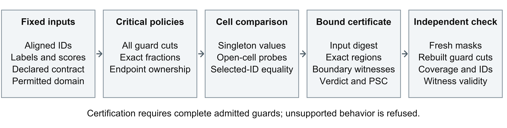
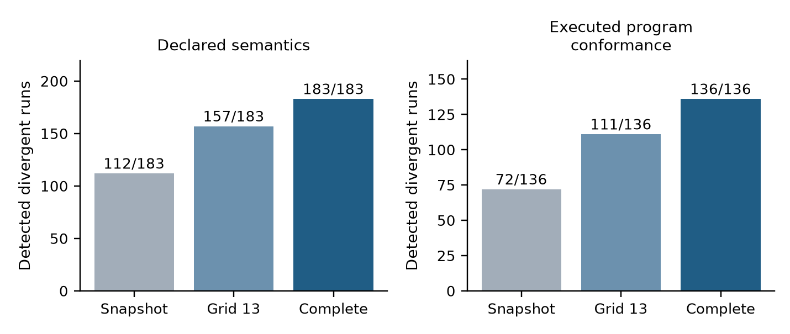
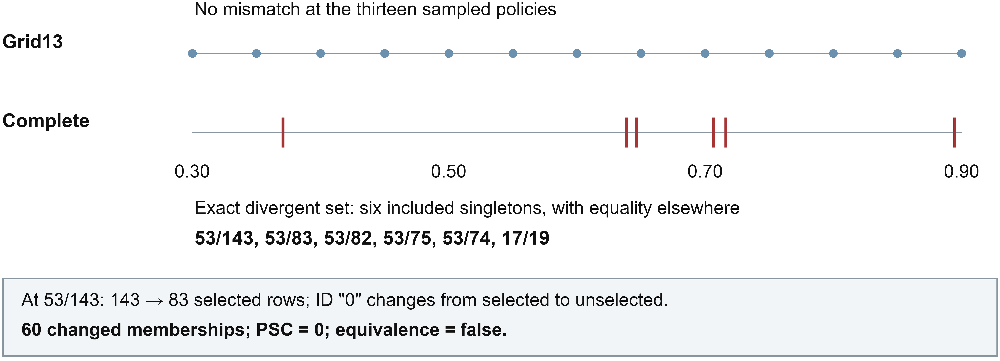
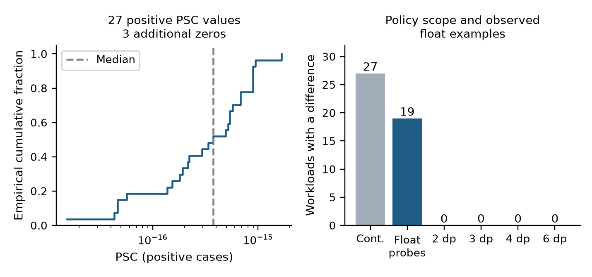

# Exact Policy-Aware Regression Diagnosis for Precision-Constrained Threshold Selectors

## Abstract

Regression tests at selected precision targets can miss changes in the observation IDs chosen elsewhere in a permitted policy domain. We study how to establish and independently check selected-ID equivalence throughout that domain for fixed labeled observations. The method combines an explicit finite selector contract, a complete set of policy-changing cuts, endpoint-sensitive comparison and an input-bound diagnostic certificate. Completeness is conditional on the candidate family, priorities and numerical-interface guards being fully represented. Evaluation separates formal-contract checks, controlled executable variants, documented upstream defects and engineering costs. Complete checking identifies all 183 configured divergent variants and all 136 executed nonconforming runs, whereas a thirteen-point grid identifies 157 and 111, respectively. A recorded WDBC case exposes six singleton mismatches missed by the grid despite zero divergent interval length. On two documented upstream defects, both methods identify the same affected workloads; the additional result is complete localization and checkable membership evidence. Computational studies show the cost of obtaining that evidence and the distinct effects of consumer implementation and query output requirements. The findings support conditional policy-wide diagnosis, rather than a general verification algorithm or an industrial defect-detection rate.

Keywords: regression diagnosis; precision constraints; selected-ID equivalence; numerical-interface semantics; independently checked certificates.

## 1 Introduction

### 1.1 Background and Motivation

Precision-constrained threshold selectors convert numerical scores into a set of observations for review or intervention. An alerting component in decision-support software may support several precision targets as operating conditions change. A software modification must then be assessed against the permitted targets, rather than only the target selected for one regression test. This motivates the study; the evaluation does not assess an entire deployed alerting or cold-chain information system.

The relevant outcome is the selected set of observation IDs. Score differences alone do not determine whether that set changes, while agreement at one precision target does not establish agreement at other targets. Fixed labels and aligned IDs make this a finite empirical question: given two score/selector versions and a declared policy domain, where do selected memberships differ, who owns each boundary, and what evidence lets another implementation check the answer?

An existence test and a complete diagnosis answer different questions. A failing grid test supplies one observed difference. A complete diagnosis must also establish the scope outside that observation and retain isolated policy values. A singleton mismatch has zero interval length, so an interval-length summary cannot replace an equivalence verdict. Numerical interfaces create a further distinction: an exact decimal policy and the exact rational embedding of a binary64 value need not denote the same target.

### 1.2 Research Gap and Related Work

Constrained threshold selection has established foundations [1–3], with documented calibration and public selector interfaces [5,21,22]. Regression verification [8], parameter synthesis [6,7,20], predicate enumeration and AllSMT [23–25] already provide ways to reason beyond sampled inputs. Certifying computations [9,17] and proof-carrying approaches [10] establish the separation between producing a result and checking evidence. Metamorphic testing of classifiers and optimization software [4,11,12], robust classification [18] and parametric monitoring [19] address related testing or parameter-dependent questions.

The question studied here is how those foundations can establish one specific observable under one explicit contract: selected-ID equality throughout a permitted precision domain, including endpoint ownership and the actual numerical policy interface. A complete-region answer is useful only if its cuts cover every admitted change, its memberships refer to the same observations, and its certificate can be checked against the original inputs. For executable adapters, those requirements must also delimit when collected guard events are sufficient and when the method must refuse certification.

The resulting contribution is a unified diagnostic specification and its evaluated implementation. Finite partitioning, interval search and producer/checker separation remain established techniques. The study identifies sufficient conditions for applying them to this selector contract and tests whether the resulting diagnostic obligations hold across controlled changes, numerical interfaces and documented defect replays. This focused question does not require claiming that earlier verification methods cannot represent complete regions.

### 1.3 Research Objectives and Contributions

The objective is to establish selected-ID equivalence, or an exact counterexample region, across the caller's permitted policy domain and make that result independently checkable. The formal contribution specifies the candidate, guard and identity conditions under which finitely many singleton and open-cell observations suffice, including binary64 rounding cuts. The evidential contribution specifies an input-bound record and consumer obligations for coverage, membership, boundary ownership and observation witnesses. The empirical contribution distinguishes coverage failures on controlled variants from localization on documented upstream defects and measures the cost of retaining checkable diagnostics.

Streaming consumption, the Boolean query index and CLI integration are supporting implementations. Their experiments assess engineering feasibility under the same diagnostic contract; they are not separate claims of new general verification primitives. The evaluation uses fixed observation arrays and recorded outcomes, with workload dependence and numerical assumptions made explicit.

### 1.4 Research Questions

RQ1 — Correctness: Does the implementation satisfy the finite contract's equivalence, coverage, endpoint and witness obligations on the evaluated inputs?

RQ2 — Testing effectiveness and diagnosis: What do complete checking and point-based tests reveal on controlled variants and documented upstream defects, and what exact diagnostic information is added?

RQ3 — Computational cost: What are the costs of constructing and independently checking complete diagnostics under matched output obligations?

RQ4 — Policy-domain interpretation: How do declared policy sets and numerical-interface semantics change the diagnostic answer, and what costs accompany certificate reuse?

## 2 Research Methodology

The design has three layers. The formal diagnostic method defines the observable, completeness conditions and certificate obligations (§2.1–2.3). Empirical validity studies challenge those conditions with fixed-input comparisons, executable changes, numerical interfaces and documented defects (§2.4). Engineering feasibility studies measure production, checking and query costs under separately specified protocols (§2.5). Figure 1 shows the common workflow; optimizations operate within it.

Figure 1 Diagnostic workflow under the admitted finite contract. A complete input-bound record is checked against original inputs; unsupported semantics are refused.

### 2.1 Problem Formulation and Selector Contract

Observation IDs are unique and aligned across versions; labels are binary and fixed, and scores are finite. Each version s has a finite family of nonempty threshold candidates. A candidate contains a complete score-tie group prefix, with actual positive count k and selected size n. Inclusive feasibility compares its exact empirical precision k/n with policy alpha. Among feasible candidates the reference selector maximizes actual positive count, then selected size; it abstains if none is feasible or all labels are negative. The following expression uses a version index consistently for the maximizer and selected set.

$$j_s^*(\alpha)=\arg\max_{j:\alpha n_{s,j}\le k_{s,j}}(k_{s,j},n_{s,j}),\quad S_s(\alpha)=C_{s,j_s^*(\alpha)}$$

The permitted domain A=[L,H] has exact rational endpoints with 0<=L<H<=1. Alpha=0 follows the same feasibility and abstention rules. Alternative candidate families, fixed priorities and strict-feasibility contracts are represented explicitly in the controlled studies; they do not silently change the reference objective. The output is a Boolean equivalence verdict, complete divergent cells with boundary closure, and an observation witness for each distinct divergent state.

$$D_A=\{\alpha\in[L,H]:S_{old}(\alpha)\ne S_{new}(\alpha)\},\quad PSC=\frac{\operatorname{length}(D_A)}{H-L}$$

PSC is the exact divergent interval-length fraction. It is neither a deployment probability nor a substitute for the Boolean verdict: an affected singleton contributes zero length. Selected counts also do not generally establish selected-ID equality, because score order may change between versions. The method therefore checks memberships under aligned identities.

### 2.2 Exact Policy-Domain Verification

Completeness requires a fixed finite candidate family, policy-independent candidate memberships and priorities, and a complete representation of every feasibility-guard change. For exact rational guards, the critical set B contains L, H and every candidate feasibility ratio of either version strictly inside A. These conditions are assumptions of the theorem, not consequences of observing a few executable traces.

**Finite partition theorem.** Under those conditions, both selected memberships are constant on every open interval between consecutive values of B. Equality throughout A holds if and only if memberships agree at every singleton B value and one representative in each nonempty open interval.

**Proof.** No admitted feasibility predicate changes inside an open interval without crossing its fixed ratio. Fixed memberships, priorities and abstention then keep the selected set constant. Singletons and open intervals partition the domain, giving necessity and sufficiency. Singleton tests retain inclusive/strict boundary behavior; midpoint testing is sufficient only after the complete critical set is established.

For a public binary64 policy interface, a guard can change at a rounding preimage rather than at the displayed rational precision. If p is an observed finite binary64 precision and q is its next larger representable value, nearest-even conversion changes side at the exact rational midpoint c=(p+q)/2; equality at c belongs to the even significand [26]. The admitted model uses the union of those guard cuts, rational-reference ratios and domain endpoints, with explicit ownership. It requires the stated conversion mode and policy-independent candidates and priorities. Additional state or unrepresented policy-dependent branches invalidate the coverage argument.

The implementation sorts scores, forms exact TP/N ratios and sweeps the critical policies. Fixed-priority candidates are discarded when they become infeasible. For equal-sized score prefixes, inverse ranks and prefix maxima test selected-ID equality in constant time after preprocessing; distinct divergent state pairs are scanned for changed-row counts and an ID witness. Adjacent identical states are merged only while preserving boundary closure. For N rows, G total candidates, K critical values and D distinct divergent state pairs, core work is O(N log N + G log G + K), with O(ND) witness work and O(N+G+K) auxiliary storage under unit-cost rational operations. Arbitrary-precision operand costs, hashing and serialization are additional. Complete proofs and their assumptions are in Supplement S1.

### 2.3 Independent Certificate Checking and Executable Admission

A certificate binds the inputs by SHA-256 and records selector contracts, domain, critical fractions, cells, membership counts, equivalence, witnesses and PSC. The independent consumer reconstructs threshold masks from the original arrays, derives its own critical values and verifies coverage, unique endpoint ownership, winners, actual memberships, witnesses and changed-row counts. It recomputes the verdict and divergent length. Agreement of counts alone is insufficient, and checking one witness alone does not verify an entire negative region.

The certificate is an independently consumable diagnostic object, not a machine-checked proof of arbitrary Python behavior. Producer and consumer have separate implementations but share the mathematical contract and numerical dependencies. The streaming consumer reduces retained mask materialization without removing worst-case O(NG) counting/reconstruction work; its detailed suffix reasoning, operand costs and additional sorting terms are in Supplement S1. The Boolean index changes query output work after a full certificate check and remains a supporting engineering component.

Executable-source evaluation uses an unchanged direct-mask reference, actual selected-ID outputs and an explicit admission boundary. The tested programs restrict policy dependence to the instrumented guard, keep candidates and priorities independent of policy, and retain source/input bindings and repeated guard-event consistency checks. AST checks and sampled traces alone do not establish these properties for arbitrary Python. Unreviewed sources, hidden state, unsupported policy dependence and invalid outputs are refused rather than certified. Public-library adapters instead declare their own finite-candidate and numerical-interface contracts. Supplement S3, S4 and S5 document those distinct boundaries.

### 2.4 Empirical Validity Design and Condition Coverage

The fixed-input comparison comprises 98 pairs: 50 stored comparisons, 17 frozen synthetic fixtures, one public WDBC pilot and 30 fitted pipeline inputs. The latter use ten seeded splits from each of WDBC logistic/isotonic, digits zero-vs-rest LinearSVC/sigmoid and generated imbalanced random-forest/quantized-score families. Fitting, calibration and evaluation indices are disjoint and recorded; RF reserves its unused calibration split. Evaluation labels define the empirical selector, not a deployable test-label-free prediction rule. The 255 stored grid configurations are cross-checked against their bundled CSV records.

The conditions target different assumptions rather than represent independent deployments (Table 1). The 30 pipeline inputs range from 143 to 600 rows and from 4 to 450 distinct score candidates; the fraction of observations in non-singleton score groups spans 0 to 1. These ranges are descriptive checks of the frozen arrays. Tie/candidate stress, identity violations, boundary changes and numerical conversion have different diagnostic roles; they are not pooled into one diversity score.

Table 1. Recorded condition coverage and its diagnostic purpose. Ranges describe frozen arrays; conditions are not independent deployments or a fully crossed industrial sample.

| Condition | Recorded variation | Diagnostic obligation challenged |
| --- | --- | --- |
| Ties and candidate counts | 30 pipeline inputs: N 143–600, G 4–450; tied-observation fraction 0–1. Designed G 10/30/90/250/500. | Complete tie groups, candidate selection and count-dependent work |
| Score structure and identities | Quantization, roundoff tie splitting, within-tie prefixes; 30 ID violations and aligned-permutation controls | Membership equality beyond score/count agreement; aligned identities |
| Guard and priority semantics | Inclusive/strict precision, threshold comparison, omitted candidates, reversed secondary priority and feasibility counts | Fixed contract, complete policy cuts and correct winning membership |
| Numerical representation | Controlled float32 score casts; exact rational and binary64 policy interfaces; integer-axis defect fixtures | Exact conversion cuts and endpoint ownership, with distinct query embeddings |
| Boundaries and negative controls | Singleton/open-cell probes, PSC=0 mismatches; 57 equivalent fault variants and 90 valid controls | Boolean verdict separate from interval length; scoped false alarms |
| Unsupported execution | Twelve unsupported-source fixtures and three invalid-runtime-output fixtures | Refusal rather than an unsupported completeness claim |

For each fitted base input, eight selector/numerical variants, one row-ID fault and three valid controls yield 360 records. The separate program-conformance study executes a reference and six local changed programs on the same 30 inputs. Configured-contract divergence, actual executable nonconformance and input-identity violations retain separate denominators. Fault models include feasibility, threshold comparison, candidate omission, within-tie splitting, secondary priority, counting and numerical perturbation; Supplement S3 and S6 retain operator-level details. Exhaustive tests cover 10,854 small score/label combinations, plus 1,000 seeded randomized cases and targeted endpoint, identity, abstention and tamper checks.

Two documented defects provide historical-source evidence: scikit-learn precision-recall truncation #23213/#23214 [14,15] and SciPy nearest-interpolation integer overflow #6318/#6351 [27,28]. Unchanged affected/fixed source bodies are executed through recorded compatibility bridges. The first study uses the report protocol and 30 pipeline workloads; the second uses six prespecified axes plus 30 constructed pipeline propagation fixtures. Their workloads are not independent defects or historical binary installations. SciPy release records provide dependency context [13]. The installed eval-toolkit 1.12.0 public selector [22] is a numerical-contract study, not a third confirmed defect; the installed TunedThresholdClassifierCV study [21] is another component of scikit-learn. Full contracts, source hashes and replay details are retained in Supplement S2, S5, S7 and S8.

### 2.5 Engineering Feasibility and Experimental Protocols

Snapshot and grid baselines compare actual selected IDs under the same declared task. Snapshot uses alpha=0.50; grid uses thirteen exact rational targets from 0.30 to 0.90. B4/current score guards observe score arrays and have a different scope from changed-selector execution. For complete-region costs, a direct Z3 encoding [16] must return the same maximal divergent components, endpoint ownership, PSC, verdict and rational policy/row witnesses as the partition method. Residual UNSAT is required after cell enumeration; timeout or unknown prevents certification. This is a specified solver encoding, not a benchmark of an independently optimized AllSMT tool [23–25].

Each timing claim belongs to its protocol. Traced certificate production includes validation, construction, input hashing and JSON serialization, with ten repetitions per condition on one recorded Windows/Python 3.12.10 host; inputs precede tracing and peak auxiliary MiB excludes process RSS. Preparation-matched timings and untraced ablation remain separate. Complete-region factorials cross N={1,000,10,000,100,000}, G={10,30,90} and three candidate-omission patterns, retaining all 27 tasks with five randomized repetitions; six larger-candidate tasks use N=10,000, G={250,500} and three repetitions. Totals include preparation, production/serialization and the same independent region checker. Paired consumers use identical prepared certificates, five untraced repetitions and separate memory runs. Full phase definitions and chronological records are in Supplement S9–S10 and S16.

Allowed-domain queries evaluate finite sets, exact decimal lattices and intervals with endpoint ownership. Representable binary64 probes are embedded by exact integer ratios and are kept separate from rational decimal targets. On 36 SciPy fixtures, eight prespecified scenarios are compared with direct masks and an independent selected-bitset Z3 encoding; witnesses are checked and unknown aborts the comparison. Reuse studies separate two certificate APIs, which both construct and independently check a complete record, from direct masks and incremental Z3, which answer the query without exporting/checking that complete record. Setup, checking, query and total costs remain separate. Supplement S13–S15 contains the request plans, repetitions and unequal assurance obligations.

## 3 Results

### 3.1 RQ1 Correctness and Exact Policy Equivalence

The recorded exact-archive execution reports 42 passing core tests and 18 passing upstream threshold tests in separate suites. The independent consumers accept all 428 application/mutation certificates across 98 bound inputs and 41,348 policy probes, checking coverage, memberships, endpoints and witnesses. Altered bindings, partitions, winners and metrics are rejected in targeted tests. These results support the implemented finite obligations on the evaluated inputs, while the proof supplies their conditional rationale. Execution logs and the distinction from earlier output snapshots are mapped in Supplement S21.

Policy sensitivity varies across the four fixed-input cohorts (Table 2). All 255 stored grid outcomes and their selected counts match the complete record. Within the 23 cases represented by those grid records, the same 15 cases are sensitive under both procedures; complete checking provides their regions. For the public WDBC pilot, the divergent set is exactly (43/51,9/10] on [3/10,9/10], with excluded left boundary, length 29/510 and PSC=29/306. The grid's affected values 0.85 and 0.90 lie inside that set. Among 30 float32-cast pipeline comparisons, only digits_svc_sigmoid_seed2 is policy-sensitive, with PSC=25/5084.

Table 2. Fixed-input cohorts and policy-sensitive comparisons under their declared domains.

| Cohort | Pairs | Policy-sensitive pairs | Domain |
| --- | --- | --- | --- |
| Independent_pipeline | 30 | 1 | [0.30,0.90] |
| Public_WDBC | 1 | 1 | [0.30,0.90] |
| Retained | 50 | 40 | [0.30,0.80] |
| Synthetic | 17 | 11 | [0.30,0.80] |

The endpoint-only example in §3.2 shows why the successful membership/coverage checks must retain the Boolean verdict separately from PSC. Neither the observed sensitive-case fraction nor certificate acceptance estimates a population defect rate or proves unrestricted program correctness.

### 3.2 RQ2 Testing Effectiveness and Diagnostic Information

Complete checking finds all 183 configured divergent variants, compared with 157 for grid13 and 112 for snapshot. Of the 26 grid misses, 15 have positive-length divergent regions and 11 differ only at critical points. In the separate executable study, guard-complete comparison finds all 136 nonconforming program/input runs, compared with 111 and 72, respectively (Figure 2). The unchanged reference supplies the executable oracle; these 136 runs are separate from the configured-contract denominator.

Figure 2 Detection under two distinct evaluation contracts. Configured divergence and executed nonconformance denominators are not pooled.

Table 3 retains the declared-contract baseline observations. Among the 360 total records, 57 fault variants are equivalent on the tested input/domain, 30 row-ID violations are rejected separately, and no exact policy alarm occurs on the 90 valid controls. B4 and the current guard raise 9 and 42 structural flags on observed policy-equivalent variant/control runs. Their different observable prevents interpreting every flag as a policy error or every missed selector change as a failure of their original score-structure task.

Table 3. Detection under declared selector semantics; the denominator excludes identity violations and valid controls.

| Test observation | Detected / 183 divergent mutants | Rate |
| --- | --- | --- |
| Selected membership at alpha=0.50 | 112/183 | 61.2% |
| Thirteen-point output harness | 157/183 | 85.8% |
| Score-only B4 structural flag (different scope) | 47/183 | 25.7% |
| Current score guard at alpha=0.50 (different scope) | 47/183 | 25.7% |
| Exact configured policy certificate | 183/183 | 100.0% |

**Recorded diagnostic case.** The strict_precision variant on wdbc_logistic_isotonic_seed0 changes inclusive feasibility to strict feasibility while keeping the scores and fixed objective. Grid13 reports no mismatch at its thirteen targets. The complete certificate records exactly six divergent singletons: {53/143, 53/83, 53/82, 53/75, 53/74, 17/19}; equality holds elsewhere in [3/10,9/10], so PSC=0 although equivalence is false (Figure 3). At alpha=53/143, the inclusive selector chooses 143 rows and the strict selector 83. Observation ID "0" is selected only by the inclusive selector, and 60 memberships differ. This is a recorded controlled variant, not a hypothetical illustration or an additional upstream defect.

Figure 3 Recorded strict-feasibility diagnosis on wdbc_logistic_isotonic_seed0. Grid agreement coexists with six singleton mismatches; zero PSC does not establish equivalence.

The case is bound to inputs/case_068.npz and results/certificates/mutation_000.json. Its mutation CSV row, complete/grid CLI reports and independent direct-mask reconstruction agree on the missed-grid outcome, singleton closure and witness. Supplement S21 gives the full locations and hash bindings. The informative result is a complete set with checkable boundary membership, rather than a larger interval-length statistic.

On the two documented upstream defects, grid13 and complete checking identify exactly the same affected workloads: 15 of 31 for scikit-learn and 31 of 36 for SciPy (Table 4). Snapshot finds 14 and 26, respectively. Fixed-source and installed-current controls have no policy false alarms. All 108 SciPy affected/fixed/current core certificates are independently replayed using actual interpolation outputs. Complete diagnostics add exact localization, endpoint ownership and replayable membership evidence, but add zero affected-workload detections over grid13 in these cases. The confirmed-defect count remains two; workloads and numerical-interface differentials are not independent bug counts.

Table 4. Detection of affected workloads in the two documented upstream defects; counts refer to workloads under the declared downstream contract, not independent bugs.

| Upstream defect | Workloads | Affected | Snapshot | Grid 13 | Complete |
| --- | --- | --- | --- | --- | --- |
| scikit-learn #23213 | 31 | 15 | 14 | 15 | 15 |
| SciPy #6318 | 36 | 31 | 26 | 31 | 31 |

### 3.3 RQ3 Computational and Verification Costs

Complete-region implementations agree on their diagnostic outputs across the 27-task smaller-candidate factorial, with 54 independently replayed certificates and 270 timing records. Partition has the lower total median in 25 of 27 tasks; the remaining two have an equal or smaller SMT median. Table 5 presents the N=100,000 slice. The six larger-candidate tasks produce another 36 timing records and twelve replayed certificates, reaching 430 critical points and 215 components; cases favouring SMT remain in Supplement S16.

Table 5. Complete diagnostic comparison at N = 100,000 over the smaller candidate-count factorial; totals include independent checking.

| G / omission | Critical points | Components | Partition total ms | SMT total ms |
|---|---|---|---|---|
| 10 / alternating | 10 | 5 | 59.26 | 78.39 |
| 10 / none | 10 | 0 | 52.90 | 65.71 |
| 10 / one | 10 | 1 | 58.68 | 64.17 |
| 30 / alternating | 27 | 13 | 111.01 | 193.82 |
| 30 / none | 27 | 0 | 100.06 | 109.05 |
| 30 / one | 27 | 1 | 103.76 | 129.67 |
| 90 / alternating | 79 | 39 | 494.01 | 1058.73 |
| 90 / none | 79 | 0 | 323.85 | 317.51 |
| 90 / one | 79 | 1 | 329.47 | 391.97 |

Certificate production and independent checking incur distinct costs. In the traced N=100,000 witness-enabled divergent condition, the production median is 528.06 ms (IQR 40.73), with 111 witness-bearing state cells. Its witness-disabled counterpart is 520.59 ms (IQR 120.04); these noisy condition medians do not isolate witness cost by subtraction. The full production and phase records are in Supplement S9–S10 and S16.

On identical prepared certificates, the streaming consumer lowers median checking time in all six paired conditions and substantially reduces retained memory at larger N (Table 6). At N=100,000 on the divergent fixture, the paired medians are 35,034.92 ms for legacy and 3,557.72 ms for streaming; separately traced peaks are 169.85 and 6.00 MiB. This isolates an implementation tradeoff within the consumer obligation. It neither compares against a different producer protocol nor removes the consumer's worst-case counting work. The supporting plot and implementation details are in Supplement S17.

Table 6. Paired independent-consumer timing and separately traced auxiliary memory on identical fixtures.

| N / fixture | Legacy median (IQR), ms | Streaming median (IQR), ms | Legacy peak MiB | Streaming peak MiB |
|---|---|---|---|---|
| 1,000 / invariant | 6.41 (0.67) | 2.56 (0.15) | 0.04 | 0.04 |
| 1,000 / divergent | 26.98 (1.38) | 6.24 (0.46) | 0.09 | 0.04 |
| 10,000 / invariant | 130.23 (12.14) | 27.72 (6.19) | 1.33 | 0.63 |
| 10,000 / divergent | 1859.66 (59.43) | 145.62 (22.20) | 3.56 | 0.63 |
| 100,000 / invariant | 7097.14 (759.47) | 1843.19 (48.92) | 61.42 | 6.00 |
| 100,000 / divergent | 35034.92 (360.42) | 3557.72 (139.89) | 169.85 | 6.00 |

### 3.4 RQ4 Policy Domains and Certificate Reuse

The numerical-interface study exposes a difference between continuous-domain diagnosis and membership of a declared query set. Of 30 eval-toolkit workloads, 27 have positive rational-reference PSC and three have zero PSC; the positive median is 3.747190e-16. Exact intersection finds no affected policy on any of the four declared rational decimal lattices. A separate set of 196 representable-binary64 probes exposes differences on 19 workloads. These are different policy embeddings, not contradictory measurements of one query set (Figure 4).

Figure 4 Numerical-interface outcomes under different policy embeddings. Decimal-lattice bars are exact complete intersections; binary64 probes are a separate finite query set. These are not deployment probabilities.

The rational-reference/public-interface guard model agrees with all 884 critical-point/midpoint observations and 1,500 public calls, including baselines. The binary64 probe study compares each representable value by its exact integer ratio, whereas decimal lattices retain exact decimal targets. For illustration, representable float 0.4 exceeds exact 2/5: the five-row [1,1,0,0,0] ordered-score example selects five versus four at that float's rational embedding, while both select five at exact 2/5. This explains interface semantics; it is separate from the recorded missed-grid case in §3.2 and adds no confirmed library bug. Full distributions, exact intersections and the observed 41-of-64 maximum changed-ID count remain in Supplement S8.

On the 36 SciPy fixtures, all 288 allowed-domain query answers agree with independent Z3 checking, with no unknown result. Finite-set and two-/three-place lattice checks cover 24,408 explicit policies; finer lattices use exact intersections. The continuous interval affects 31 workloads, while the declared set {0.50,0.80,0.90} affects 30 (Table 7). At two decimal places, 1,611 of 2,196 allowed policy/workload pairs are affected. Those counts describe fixture coverage under declared scenarios, not deployment frequencies.

Table 7. Verified certificate reuse for eight declared policy-domain scenarios on the same 36 workloads.

| Allowed policy scenario | Policies per workload | Workloads with an affected target | Affected policy/workload pairs |
|---|---|---|---|
| Thirteen-point grid | 13 | 31 / 36 | 340 |
| Declared set {0.50,0.80,0.90} | 3 | 30 / 36 | 86 |
| Decimal lattice 2 places | 61 | 31 / 36 | 1,611 |
| Decimal lattice 3 places | 601 | 31 / 36 | 15,886 |
| Decimal lattice 4 places | 6,001 | 31 / 36 | 158,657 |
| Decimal lattice 6 places | 600,001 | 31 / 36 | 15,863,561 |
| Closed interval [0.30,0.90] | Continuous | 31 / 36 | Not a finite count |
| Closed interval [0.80,0.90] | Continuous | 30 / 36 | Not a finite count |

Certificate reuse changes costs without changing that diagnostic contract. The paired API study retains 960 timing records, 192 groups and 40,560 agreeing repeated method answers over 2,028 existing query plans. At batch 128, the Boolean API lowers query-phase medians in all twelve paired combinations, but lowers total medians, including setup and full checking, in eleven. Against direct masks it has lower totals in 2/6 point and 6/6 window cases under unequal certificate obligations. Thus query-phase speedups do not establish an end-to-end break-even guarantee. Detailed route obligations, total-cost tables and all batches are in Supplement S13–S15 and S17.

## 4 Discussion

### 4.1 Interpretation of the Main Findings

The central finding is that policy-wide selected-ID diagnosis requires explicit coverage and ownership information that point observations and interval length do not supply by themselves. The recorded WDBC strict-feasibility case makes this distinction concrete: grid13 sees agreement, PSC is zero, yet six admitted policy values change membership. The result follows from the contract and exact boundary semantics, with an observation-level witness available for replay.

The upstream studies answer a different question. Because grid13 detects every affected workload in both documented cases, they establish applicability and diagnostic scope rather than an external detection advantage. A certificate adds the complete location of the change and binds it to inputs and memberships that another implementation can check. That is a technical basis for inspection and handoff; debugging speed, organizational adoption and release-decision quality were not measured.

### 4.2 Relationship to Existing Verification and Testing Approaches

The contribution specifies and evaluates one diagnostic object within established verification foundations. Parameter synthesis and AllSMT already explore regions [6,7,20,23–25]; direct SMT can express the selected-ID questions [16]. Regression verification compares related programs under its own assumptions [8], while certifying computations and proof-carrying approaches motivate separate evidence consumption [9,10,17]. This work makes the selector's identities, priorities, numerical-interface cuts and certificate checks explicit together. Streaming and interval indexing are implementation choices supporting that object, not replacements for those foundations.

Finite testing remains sufficient when the required domain is an explicitly finite set and every member is checked. For an interval, the completeness claim instead depends on deriving every admitted change point. The cost experiments accordingly separate matched complete-region output from Boolean request cost with unequal assurance. They do not rank general AllSMT implementations or establish a universal advantage over direct masks. Related classifier testing [4,11,12], robust classification [18] and parametric monitoring [19] address different observables, as detailed in Supplement S24.

### 4.3 Implications for Regression Diagnosis and Release Assurance

A release requirement should declare observation identities, selector semantics, numerical conversion and the policies to preserve. A diagnostic result can then distinguish checked equivalence, an exact affected region with a witness, and refusal because assumptions are unsupported. An affected singleton must not be erased by a numerical tolerance or hidden by zero PSC. Conversely, a rational-reference difference does not become an upstream defect unless that contract is actually required.

Whether retaining a certificate is worthwhile depends on the need for persistent, independently checkable scope and on construction, checking, storage and query costs. Streaming reduces one consumer's retained masks, and the Boolean index avoids unnecessary intersection output; both preserve setup obligations. A small fixed policy set can favour direct masks. Broader human or deployment benefits require prospective evaluation, rather than inference from repeated query timings.

### 4.4 Threats to Validity and Limitations

Internal and construct validity depend on a shared mathematical contract, correctly represented guard changes and faithful adapters. Separately coded consumers can share conceptual errors, and finite tests are not machine-checked proofs. Input hashes bind bytes, not dataset authenticity or label quality. In particular, AST restrictions and consistent sampled guard events cannot certify arbitrary stateful Python programs; refusal is part of the admitted method.

External validity is limited by related stored comparisons, three local pipeline families, hand-designed variants and two historical-source defect replays with compatibility bridges. The condition-coverage table shows which assumptions are challenged, not a representative distribution of deployed systems. Seeds and constructed propagation fixtures are not independent deployments or bugs. No production-policy inventory, independent developer study or native Linux full execution is established.

Performance validity is restricted to recorded hosts, input structures, repetition counts and instrumentation. Traced and untraced protocols, producer and consumer work, and equal versus unequal certificate obligations remain separate. Arbitrary-precision operands and O(NG)/O(ND) checking or witness work can dominate. The focused 28-source comparison also does not establish absence of closer work or general algorithmic originality.

## 5 Conclusion

Selected-ID equivalence across a permitted policy domain is conditionally reducible to finitely many exact membership checks when candidate identities, fixed priorities and every numerical guard cut are represented. Retaining singleton ownership and checking an input-bound certificate preserve information that sampled agreement and divergent interval length can lose. The recorded six-singleton case demonstrates that distinction on an evaluated input.

Controlled studies support the implemented diagnostic obligations and expose missed point coverage; two documented upstream defects support applicability and exact localization with no additional affected-workload detection over grid13. Engineering studies quantify the costs of obtaining and reusing checkable diagnostics. The result is an evaluated specification for this finite selector contract; wider program classes, independent deployments and human decision benefits remain open empirical questions.

## Reproducibility and Data Availability

The submission package provides Reproducibility_Artifact.zip and Reproducibility_Evidence.zip alongside the manuscript and supplementary material for reviewer access. The exact artifact SHA-256 is bf4ad2b56d9d3ba836494674e3493e75966c8e28763c6ac5bcf6b40954d36591. It supplies frozen inputs, source, tests, measurements, certificates, dependency specifications and the eval-toolkit wheel; it is not a complete bundled Python environment. Source, dependency and dataset licenses accompany their respective materials.

After extraction and dependency installation under the recorded Python 3.13.18 environment, the single computational entry point is `python run_all.py` from the artifact root. The detached report records 33 successful stages in 2,345.58 seconds on Windows, including 42 core tests and 18 separate upstream tests. This is a recorded duration, not a runtime bound. Frozen-input reproduction is the default; historical dependency-binary re-execution and optional model retraining have additional requirements and distinct assurance scopes. Supplement S21 gives installation commands, environment versions, expected outcomes, manifest identities and the result-to-file map.

The reading copy uses recorded benchmark snapshots. Regenerated execution timings retain their own records, and not every output is byte-identical. The Evidence package distributes all changed/new output bytes with a field-level reconciler; it separates record verification from independent computational execution. Historical manuscript-generation stages can regenerate earlier editorial layouts, so the current Word text is supplied separately. No new full-pipeline execution is claimed for this document revision.

## Declaration of generative AI and AI-assisted technologies in the manuscript preparation process

OpenAI Codex (OpenAI) assisted with manuscript organization, language revision, mathematical presentation, document formatting and authoring scripts. The associated research artifact also contains assistant-generated code and prose. Responsibility for evaluating and approving the scientific claims, software, references and final publication remains with the human authors.

## References

[1] Rath, P.; Hughes, M. (2022). Optimizing Early Warning Classifiers to Control False Alarms via a Minimum Precision Constraint. PMLR 151, 4895–4914. https://proceedings.mlr.press/v151/rath22a.html

[2] Mackey, A.; Luo, X.; Eban, E. (2018). Constrained Classification and Ranking via Quantiles. https://arxiv.org/abs/1803.00067

[3] Tasche, D. (2018). A plug-in approach to maximising precision at the top and recall at the top. https://arxiv.org/abs/1804.03077

[4] Duque-Torres, A.; Klammer, C.; Fischer, S.; Pfahl, D.; Ramler, R. (2025). Assessing the strength of Metamorphic Testing applied to optimisation software—Experience from industry. Information and Software Technology, 186, 107807. https://doi.org/10.1016/j.infsof.2025.107807

[5] scikit-learn developers. CalibratedClassifierCV, version 1.9.1 documentation. https://scikit-learn.org/stable/modules/generated/sklearn.calibration.CalibratedClassifierCV.html (accessed 30 October 2026).

[6] Storm project. Running Storm on Parametric Models. Official documentation. https://www.stormchecker.org/documentation/usage/running-storm-on-parametric-models (accessed 30 October 2026).

[7] Junges, S.; Ábrahám, E.; Hensel, C.; Jansen, N.; Katoen, J.-P.; Quatmann, T.; Volk, M. (2024). Parameter synthesis for Markov models: covering the parameter space. Formal Methods in System Design, 62, 181–259. https://doi.org/10.1007/s10703-023-00442-x

[8] Godlin, B.; Strichman, O. (2009). Regression Verification. DAC. Author manuscript: https://ofers.dds.technion.ac.il/publications/dac09.pdf

[9] Alkassar, E.; Böhme, S.; Mehlhorn, K.; Rizkallah, C. (2013). A Framework for the Verification of Certifying Computations. https://arxiv.org/abs/1301.7462

[10] Necula, G. C.; Schneck, R. R. (2002). Proof-Carrying Code with Untrusted Proof Rules. International Symposium on Software Security. Author manuscript and formalization: https://people.eecs.berkeley.edu/~necula/ISSS02/

[11] Yang, Y.; Li, Z.; Wang, H.; Xu, C.; Ma, X. (2021). Towards effective metamorphic testing by algorithm stability for linear classification programs. Journal of Systems and Software, 180, 111012. https://doi.org/10.1016/j.jss.2021.111012

[12] Xie, X.; Ho, J. W. K.; Murphy, C.; Kaiser, G.; Xu, B.; Chen, T. Y. (2011). Testing and validating machine learning classifiers by metamorphic testing. Journal of Systems and Software, 84(4), 544–558. https://doi.org/10.1016/j.jss.2010.11.920

[13] SciPy project. Release news and versions 1.15.3 and 1.18.1. https://scipy.org/news/

[14] scikit-learn issue #23213 (2022). precision_recall_curve is not returning the full curve at high recall. Upstream bug report and maintainer discussion. https://github.com/scikit-learn/scikit-learn/issues/23213

[15] scikit-learn PR #23214 (2022). FIX compute precision-recall at 100% recall. Merged 2 May 2022. https://github.com/scikit-learn/scikit-learn/pull/23214

[16] de Moura, L.; Bjørner, N. (2008). Z3: an efficient SMT solver. TACAS. https://www.microsoft.com/en-us/research/publication/z3-an-efficient-smt-solver/

[17] McConnell, R. M.; Mehlhorn, K.; Näher, S.; Schweitzer, P. (2011). Certifying algorithms. Computer Science Review, 5(2), 119–161. https://doi.org/10.1016/j.cosrev.2010.09.009

[18] Provost, F.; Fawcett, T. (2001). Robust Classification for Imprecise Environments. Machine Learning, 42, 203–231. https://arxiv.org/abs/cs/0009007

[19] Chen, F.; Roşu, G. (2009). Parametric trace slicing and monitoring. TACAS, 246–261. https://experts.illinois.edu/en/publications/parametric-trace-slicing-and-monitoring/

[20] Dehnert, C.; Junges, S.; Jansen, N.; Corzilius, F.; Volk, M.; Bruintjes, H.; Katoen, J.-P.; Ábrahám, E. (2015). PROPhESY: A PRObabilistic ParamEter SYnthesis Tool. CAV, LNCS 9206, 214–231. https://www.cs.ru.nl/personal/nilsjansen/files/publications/dehnert-et-al-cav-2015.pdf

[21] scikit-learn developers. TunedThresholdClassifierCV API: callable scorer, explicit threshold arrays and prefit configuration. https://scikit-learn.org/stable/modules/generated/sklearn.model_selection.TunedThresholdClassifierCV.html (accessed 30 October 2026).

[22] Behring, B. eval-toolkit: threshold selection methodology and source. https://brandon-behring.github.io/eval-toolkit/methodology/thresholds.html ; pinned packaging/source at https://github.com/brandon-behring/eval-toolkit/tree/a6400e74c4534d6d79f17dee11ad903b6d664980 (accessed 30 October 2026).

[23] MathSAT developers. API reference: msat_all_sat, enumeration over important atoms. https://mathsat.fbk.eu/apireference.html (accessed 30 October 2026). Used to contextualize predicate enumeration, not as an evaluated implementation.

[24] Morettin, P.; Passerini, A.; Sebastiani, R. (2017). Efficient Weighted Model Integration via SMT-Based Predicate Abstraction. IJCAI, 720–728. https://www.ijcai.org/proceedings/2017/100

[25] Spallitta, G.; Sebastiani, R.; Biere, A. (2025). Disjoint projected enumeration for SAT and SMT without blocking clauses. Artificial Intelligence, 345, 104346. https://doi.org/10.1016/j.artint.2025.104346

[26] Andrlon, M. (2023). Finding Normal Binary Floating-Point Factors Efficiently. Journal of Automated Reasoning, 67, article 11. https://doi.org/10.1007/s10817-023-09659-1

[27] SciPy issue #6318 (2016). Scipy interp1d nearest not working for high values on x-axis. Upstream defect report. https://github.com/scipy/scipy/issues/6318

[28] SciPy PR #6351 (2016). BUG: #6318 Interp1d nearest integer x-axis overflow issue fixed. Merged 6 July 2016. https://github.com/scipy/scipy/pull/6351
